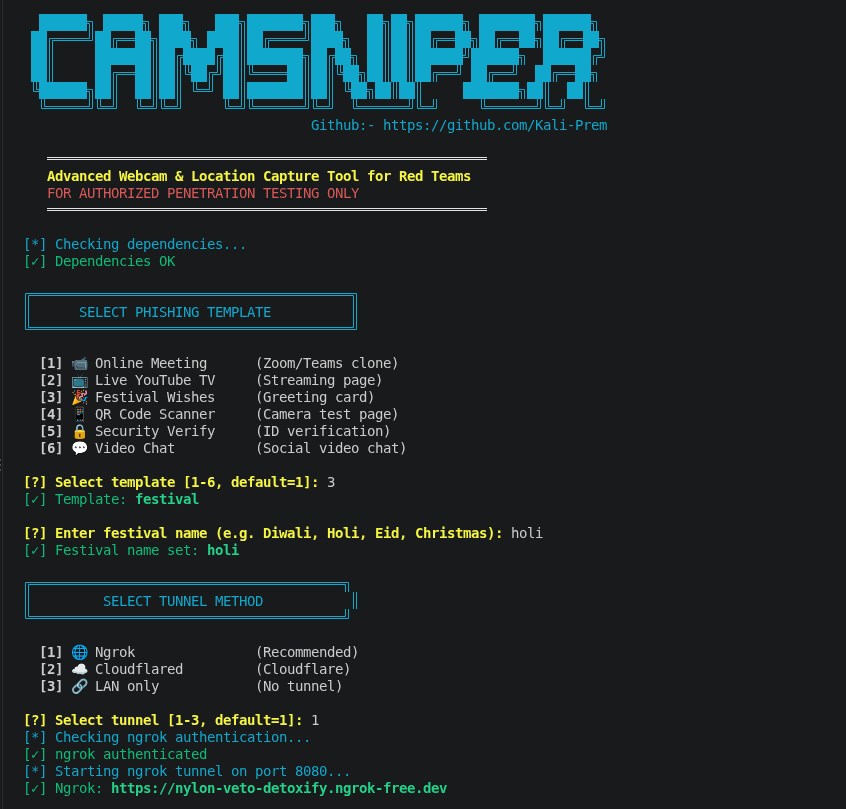
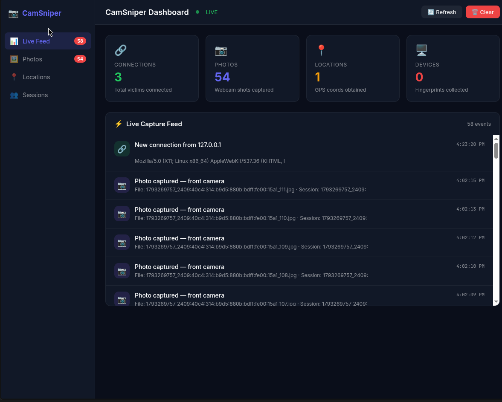

<div align="center">

# 📷 CamSniper v1.0

**Advanced Webcam & Location Capture Tool for Red Teams**

[](https://python.org)
[](https://flask.palletsprojects.com)
[](https://flask-socketio.readthedocs.io)
[](LICENSE)
[](https://github.com)
[]()

> **⚠️ FOR AUTHORIZED PENETRATION TESTING ONLY**  
> **⚠️ FOR EDUCATIONAL PURPOSES ONLY**  
> Always obtain explicit written permission before using this tool against any target.  
> Unauthorized use is illegal and unethical.

---

</div>

### Terminal — camsniper-terminal-interface.png




## 📋 Table of Contents

- [⚠️ Legal Disclaimer](#-legal-disclaimer)
- [🎯 Overview](#-overview)
- [✨ Features](#-features)
- [🎭 Phishing Templates](#-phishing-templates)
- [📍 Exact vs Fake Location](#-exact-vs-fake-location)
- [📦 Requirements](#-requirements)
- [🚀 Installation](#-installation)
- [💻 Usage](#-usage)
- [🖥️ Web Dashboard](#-web-dashboard)
- [📸 Captured Data](#-captured-data)
- [📸 Screenshots](#-screenshots)
- [🔧 Troubleshooting](#-troubleshooting)
- [🛡️ Ethical Usage Guidelines](#-ethical-usage-guidelines)
- [⚖️ License](#-license)

---

## ⚠️ Legal Disclaimer

> **CamSniper is provided for EDUCATIONAL and AUTHORIZED SECURITY TESTING purposes only.**
>
> The developers and contributors are **NOT** responsible for any misuse, damage, or illegal activities caused by this tool. By downloading and using CamSniper, you agree that:
>
> 1. You have **explicit written authorization** from all targets
> 2. You take **full legal responsibility** for how you use this tool
> 3. You will comply with all applicable **local, state, and federal laws**
> 4. You will **not use this tool** for any unauthorized or illegal purposes
>
> Unauthorized use of this tool may violate the **Computer Fraud and Abuse Act (CFAA)**, **IT Act 2000** (India), or equivalent laws in your country.

---

## 🎯 Overview

**CamSniper** is a professional-grade webcam & location phishing simulation tool built for **authorized red team engagements and penetration testing**. It deploys convincing phishing pages that capture:

- 📷 **Webcam photos** (front & back camera, continuously)
- 📍 **Exact GPS coordinates** with Google Maps link
- 🌐 **IP address** with full geolocation (country, city, ISP)
- 🖥️ **Device fingerprint** (OS, browser, screen, hardware info)
- 🔋 **Battery status**, connection type, timezone

All data is displayed in **real-time** via a beautiful web dashboard and a rich terminal monitor.

---

## 🎭 Phishing Templates

| # | Template | Lure | Camera Used |
|---|----------|------|-------------|
| 1 | 📹 **Online Meeting** | Google Meet clone | Front |
| 2 | 📺 **YouTube Live TV** | Age verification popup | Front |
| 3 | 🎉 **Festival Wishes** | "Take a celebration selfie" | Front |
| 4 | 📱 **QR Scanner** | Camera scanner app | Back + Front |
| 5 | 🔒 **Security Verify** | Facebook-style ID verification | Front |
| 6 | 💬 **Video Chat** | Social video chat | Front |

---

## 📍 Exact vs Fake Location

### 🚫 Other Tools
Most phishing tools capture **fake or approximate location** based only on IP geolocation, which can be hundreds of kilometers away from the actual target location.

### ✅ CamSniper
CamSniper captures **EXACT GPS location** using the browser's `navigator.geolocation` API with `enableHighAccuracy: true`. It:
- Retries GPS capture up to 3 times
- Falls back to `watchPosition` for continuous tracking
- Falls back to IP geolocation only if GPS is completely denied
- Detects and flags suspicious/fake locations (GPS vs IP distance > 200km)
- Provides clickable Google Maps links in the dashboard

> **When the target allows location permission, CamSniper captures the exact GPS coordinates — not an IP-based approximation.**


---

## 📦 Requirements

```bash
pip3 install flask flask-socketio requests colorama rich
```

Or install from `requirements.txt`:
```bash
pip3 install -r requirements.txt
```

---

## 🚀 Installation

```bash
# Clone the repository
git clone https://github.com/Kali-Prem/CamSniper.git
cd CamSniper

# Make the launcher executable
chmod +x camsniper.sh

# Run the tool
./camsniper.sh
```

---

## 💻 Usage

1. Run the launcher:
   ```bash
   ./camsniper.sh
   ```

2. Select a phishing template (1-6)
3. If you select **Festival**, enter a custom festival name (e.g., Diwali, Holi, Eid, Christmas)
4. Select a tunnel method:
   - **[1] Ngrok** (Recommended — provides HTTPS for camera/location access)
   - **[2] Cloudflared** (Cloudflare tunnel)
   - **[3] LAN only** (Local network only)
5. Share the generated phishing URL with the authorized target
6. Monitor captures in real-time via the dashboard or terminal monitor

---

## 🖥️ Web Dashboard

Access the real-time dashboard at: `http://localhost:8080/dashboard`

The dashboard displays:
- 🔗 New connections with IP & geolocation
- 📍 GPS locations with clickable Google Maps links
- 📷 Captured webcam photos
- 🖥️ Device fingerprint information
- 📊 Real-time statistics

### Dashboard Thumbnail



---

## 📸 Captured Data

All captured data is stored in the `captures/` directory:

```
captures/
├── photos/     ← Captured webcam JPEGs
└── data/       ← Session JSON files
```

Logs are saved to:
```
logs/
└── captures.jsonl  ← Event log (JSON Lines)
```
---

## 📸 Screenshots

### Terminal — Template Selection & Tunnel Setup


### Terminal — CamSniper Ready with Phishing URL


### Terminal — camsniper-terminal-interface.png


### Web Dashboard — Exact GPS Location Captured


> **Note:** Latitude and longitude coordinates in screenshots are blurred for privacy protection.

---

## 🔧 Troubleshooting

### Server won't start
```bash
# Check if port is already in use
lsof -i :8080

# Kill existing process
pkill -f server.py
```

### ngrok URL not detected
```bash
# Check ngrok is running and authenticated
ngrok http 8080

# Visit http://localhost:4040 to see the URL
```

### Camera not working on target
- HTTPS is required for camera access in modern browsers
- Ensure you're using **ngrok** (provides HTTPS) not LAN mode
- Target must click "Allow" on browser camera permission prompt

### Location not captured
- Target must click "Allow" on browser location permission prompt
- GPS requires HTTPS (use ngrok, not localhost)
- If GPS is denied, CamSniper falls back to IP geolocation

### Python module not found
```bash
pip3 install flask flask-socketio requests colorama rich --upgrade
```

---

## 🛡️ Ethical Usage Guidelines

This tool is designed for **legitimate security professionals** engaged in authorized testing:

✅ **Allowed:**
- Authorized penetration testing with signed scope-of-work
- Red team engagements with client written permission
- Security awareness training within your own organization
- CTF (Capture The Flag) competitions
- Research on your own devices

❌ **Prohibited:**
- Testing against systems/individuals without written permission
- Deploying against real users without consent
- Using for stalking, surveillance, or harassment
- Any illegal activity in your jurisdiction

---

## ⚖️ License

This project is licensed under the **MIT License** — see the [LICENSE](LICENSE) file for details.

---
